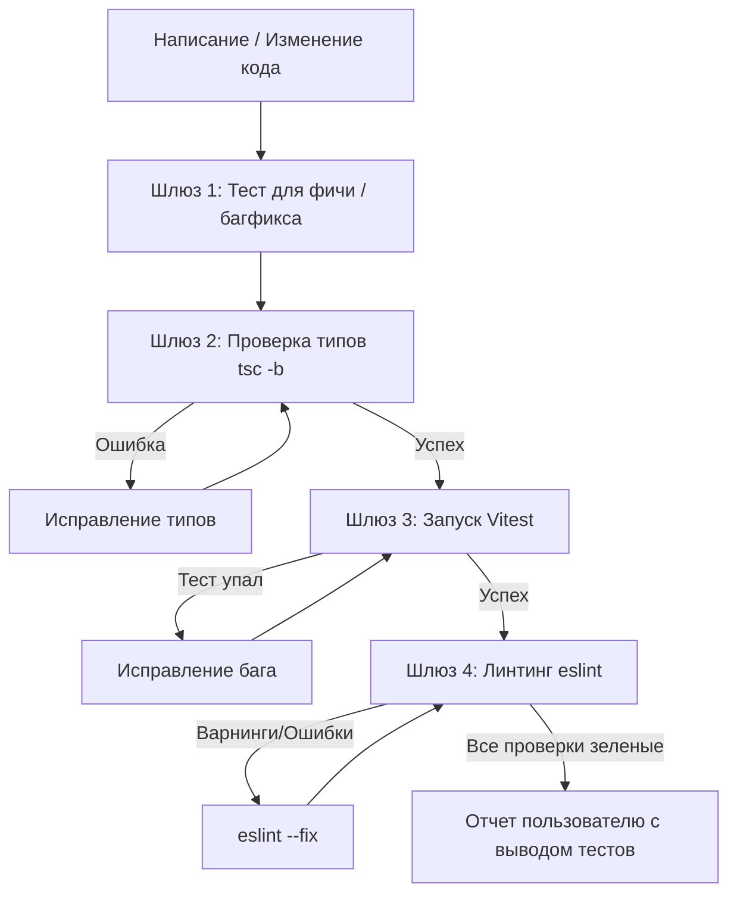

# Test-Driven Verification & Self-Check Protocol

> **Core Philosophy**: **Zero Trust in Unverified Code.**  
> ИИ-модель **никогда не объявляет задачу завершённой**, пока не запустит проверочные команды в терминале и не убедится в коде возврата `0` (зелёный статус). Фразы «код написан, должно работать» запрещены.

---

## 1. Автоматический протокол проверки (Verification Loop)

При внесении любых изменений в проект модель обязана пройти 4 шлюза проверки:



---

## 2. Команды для каждого шлюза

Всегда запускай команды проверки самостоятельно через терминал, не перекладывая это на пользователя:

| Шлюз | Команда | Что проверяет |
|---|---|---|
| **1. Types** | `npx tsc -b` | Ошибки типизации TypeScript, сломанные импорты, несовместимость пропсов |
| **2. Unit/Integration** | `npx vitest run [path]` | Работоспособность бизнес-логики, Zustand сторов, утилит, Zod схем |
| **3. Components** | `npx vitest run --testPathPattern=ui` | Рендер компонентов shadcn, взаимодействие пользователя (userEvent) |
| **4. Lint & Format** | `npx eslint [file] --fix` | Отсутствие нарушений правил, неиспользуемых переменных, циклов импорта |

---

## 3. Правило сопутствующих тестов (Co-located Tests)

Каждая новая фича или исправленный баг **должны иметь тест в том же каталоге**:

```
src/features/automations/
  ├── api/
  ├── components/
  │    ├── AutomationCard.tsx
  │    └── AutomationCard.test.tsx    # Проверяет рендер и клики
  ├── model/
  │    ├── useFlowStore.ts
  │    └── useFlowStore.test.ts       # Проверяет мутации нод и связей
  └── schemas/
       ├── triggerSchema.ts
       └── triggerSchema.test.ts      # Проверяет валидацию ключевых слов
```

---

## 4. Готовые паттерны тестов для Instagram Automation

### 4.1 Тестирование Zod-валидации (Ключевые слова и триггеры)

```ts
// src/features/automations/schemas/triggerSchema.test.ts
import { describe, it, expect } from 'vitest'
import { triggerSchema } from './triggerSchema'

describe('triggerSchema', () => {
  it('принимает корректные ключевые слова для Instagram Direct', () => {
    const validData = {
      keyword: 'КУПИТЬ',
      matchType: 'exact',
      replyMessage: 'Привет! Вот ссылка на каталог.',
    }
    const result = triggerSchema.safeParse(validData)
    expect(result.success).toBe(true)
  })

  it('отклоняет пустое ключевое слово и сообщает об ошибке', () => {
    const invalidData = {
      keyword: '',
      matchType: 'exact',
      replyMessage: 'Привет',
    }
    const result = triggerSchema.safeParse(invalidData)
    expect(result.success).toBe(false)
    if (!result.success) {
      expect(result.error.issues[0].path).toContain('keyword')
    }
  })
})
```

### 4.2 Тестирование Zustand-стора (Flow Builder ноды)

```ts
// src/features/automations/model/useFlowStore.test.ts
import { describe, it, expect, beforeEach } from 'vitest'
import { useFlowStore } from './useFlowStore'

describe('useFlowStore', () => {
  beforeEach(() => {
    useFlowStore.getState().reset()
  })

  it('добавляет ноду триггера в граф воронки', () => {
    const node = { id: 'node-1', type: 'trigger', data: { label: 'Instagram DM' }, position: { x: 0, y: 0 } }
    useFlowStore.getState().addNode(node)

    expect(useFlowStore.getState().nodes).toHaveLength(1)
    expect(useFlowStore.getState().nodes[0].id).toBe('node-1')
  })

  it('удаляет ноду и связанные с ней связи (edges)', () => {
    const node1 = { id: 'node-1', type: 'trigger', data: {}, position: { x: 0, y: 0 } }
    const node2 = { id: 'node-2', type: 'message', data: {}, position: { x: 100, y: 100 } }
    const edge = { id: 'e1-2', source: 'node-1', target: 'node-2' }

    useFlowStore.getState().addNode(node1)
    useFlowStore.getState().addNode(node2)
    useFlowStore.getState().addEdge(edge)

    useFlowStore.getState().removeNode('node-1')

    expect(useFlowStore.getState().nodes).toHaveLength(1)
    expect(useFlowStore.getState().edges).toHaveLength(0) // связь удалилась каскадно
  })
})
```

### 4.3 Тестирование компонента с пользовательскими событиями

```tsx
// src/features/automations/components/ToggleBotSwitch.test.tsx
import { render, screen } from '@testing-library/react'
import userEvent from '@testing-library/user-event'
import { describe, it, expect, vi } from 'vitest'
import { ToggleBotSwitch } from './ToggleBotSwitch'

describe('ToggleBotSwitch', () => {
  it('вызывает onToggle при клике пользователя', async () => {
    const user = userEvent.setup()
    const handleToggle = vi.fn()

    render(<ToggleBotSwitch active={false} onToggle={handleToggle} />)

    const switchElement = screen.getByRole('switch', { name: /статус бота/i })
    expect(switchElement).not.toBeChecked()

    await user.click(switchElement)
    expect(handleToggle).toHaveBeenCalledWith(true)
  })
})
```

---

## 5. Алгоритм исправления ошибок (Self-Correction Loop)

Когда команда в терминале возвращает ошибку (`exit code != 0`):

1. **Не паниковать и не удалять код целиком**:
   - Внимательно прочти стек ошибки и номер строки.
2. **Типичные ошибки и мгновенные решения**:
   - `Property 'X' does not exist on type 'Y'` → проверь DTO или схему TypeScript, добавь недостающее поле.
   - `Unable to find an element with role...` → проверь доступность (ARIA), убедись что компонент отрендерился с правильным текстом/лейблом.
   - `ReferenceError: Request/Response is not defined` → убедись, что в тестовом окружении настроен jsdom или msw.
   - `React 19 ref warning` → убедись, что не используется устаревший `forwardRef`.
3. **Повторный прогон**:
   - После исправления **повторно запусти ту же команду** (`npx vitest run ...`).
   - Только когда тест показал зелёный вывод `✓ Passed`, переходи к следующему шагу.

---

## 6. Чеклист готовности (Definition of Done)

Перед тем как сообщить пользователю «готово»:
- [ ] Запущен `npx tsc -b` — 0 ошибок типов.
- [ ] Написаны и запущены тесты (`vitest run`) для новой логики.
- [ ] Проверены граничные случаи (пустой список, ошибка сети, невалидный ввод).
- [ ] Линтер `eslint` не выдает ошибок.
- [ ] Терминальный вывод с подтверждением успехов приведён в ответе.
